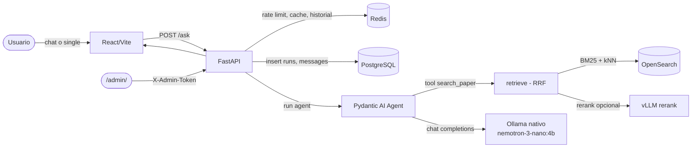
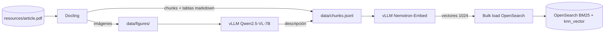
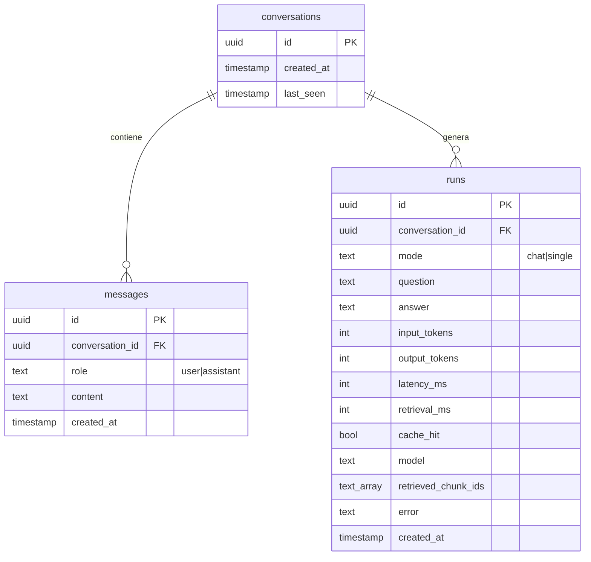

# Agente RAG sobre un survey Q1

**Integrantes:** Hervey Navarro Olazaran (código y backend) · Miguel (modelos reales, evaluación y demo).

Un agente conversacional que responde preguntas únicamente sobre un artículo
científico (survey). Recupera pasajes con búsqueda híbrida sobre OpenSearch,
los re-rankea, y un LLM razona con ellos para responder citando sección y
página. Registra cada corrida en PostgreSQL y las expone en `/admin`.

---

## 1. Resumen

El agente responde preguntas en chat o en modo "pregunta única" sobre un único
PDF. Si no hay evidencia, responde literalmente *"No está en el artículo."*.
Incluye panel `/admin` con métricas de tokens, latencia, tasa de cache hit,
errores y actividad. Todo levanta con `make smoke` usando modelos falsos; se
pasa a modelos reales cambiando `FAKE_MODELS=true` → `false` en `.env`.

---

## 2. Artículo

| Campo     | Valor                                                                                       |
| --------- | ------------------------------------------------------------------------------------------- |
| Título    | *From language to action: a review of large language models as autonomous agents and tool users* |
| Autores   | Sadia Sultana Chowa, Riasad Alvi, Subhey Sadi Rahman, Md Abdur Rahman, Mohaimenul Azam Khan Raiaan, Md Rafiqul Islam, Mukhtar Hussain, Sami Azam |
| Revista   | *Artificial Intelligence Review* (Springer)                                                 |
| Volumen   | 59, artículo 71 (2026)                                                                      |
| DOI       | [10.1007/s10462-025-11471-9](https://doi.org/10.1007/s10462-025-11471-9)                     |
| PDF local | `resources/article.pdf`                                                                     |

**Cuartil Q1:** *Artificial Intelligence Review* es Q1 en SJR para la
categoría "Artificial Intelligence" (Springer Nature).

> **PENDIENTE (Hervey):** captura de SJR o JCR que muestre Q1 — guardar como
> `docs/evidencia_q1.png` y referenciarla aquí:
> ``.

**Por qué este survey.** Cubre exactamente el dominio del agente que
construimos (LLMs como agentes que usan herramientas), lo que da sentido a
preguntas semánticas que un sistema de recuperación debe resolver, y tiene
secciones claras, tablas y figuras — material útil para probar Docling.

---

## 3. Arquitectura

### Flujo de una pregunta



### Ingesta (una sola vez)



### Componentes del stack obligatorio

| Componente       | Rol en el proyecto                                                                                     |
| ---------------- | ------------------------------------------------------------------------------------------------------ |
| **Docling**      | Convierte el PDF a chunks jerárquicos, tablas en markdown y extrae figuras con pie y página.           |
| **Hugging Face** | Distribuye los 3 modelos (embed, rerank, VLM); `scripts/download_models.py` puebla el volumen `hfcache`. |
| **vLLM**         | Sirve `/v1/embeddings`, `/v1/score` (rerank) y `/v1/chat/completions` (VLM) compatible con OpenAI.    |
| **Ollama**       | Corre `nemotron-3-nano:4b` **nativo** en el host (GPU de Apple). Los contenedores lo llaman por `host.docker.internal:11434`. |
| **OpenSearch**   | Índice híbrido: `text` (BM25) + `knn_vector` 1024-dim HNSW cosine.                                     |
| **Redis**        | Caché de respuestas (single-mode, TTL 10 min), historial de chat (TTL 24 h), rate limit por IP (30 req/min). |
| **PostgreSQL**   | Esquema `conversations`, `messages`, `runs`; agregaciones con `percentile_cont` para `/admin`.          |
| **FastAPI**      | Endpoints `/ask`, `/healthz`, `/admin/stats`, `/admin/runs`.                                           |
| **Pydantic AI**  | Agente con herramienta `search_paper`, `output_type=Answer`, system prompt estricto.                   |
| **React**        | SPA con tres rutas: `/` (chat), `/single` (caja única), `/admin` (KPIs y corridas).                    |
| **Docker**       | Un solo compose con 4 perfiles: `default`, `models`, `ingest`, `tunnel`.                               |
| **ngrok**        | Perfil `tunnel` expone el frontend para la demo.                                                       |

---

## 4. Hardware y justificación de modelos

### Hardware

| Máquina           | RAM   | GPU                  | Rol                                             |
| ----------------- | ----- | -------------------- | ----------------------------------------------- |
| Mac de Hervey     | 8 GB  | — (Intel iGPU)       | Desarrollo con `FAKE_MODELS=true`.              |
| Mac de Miguel     | 24 GB | Apple Silicon        | Modelos reales, ingesta, evaluación y demo.     |

**Medición real en la Mac de Miguel (25-nov-2026):**

| Fuente                        | Memoria   |
| ----------------------------- | --------- |
| macOS (equipo completo)       | 20 GB     |
| Docker (5 contenedores)       | 1.08 GiB  |
| Ollama (`nemotron-3-nano:4b`) | 3.3 GB    |

> La cifra de macOS incluye el resto de procesos del sistema.
> Chip exacto: PENDIENTE (Miguel) — `system_profiler SPHardwareDataType | grep Chip`.

### Modelos

| Modelo                                   | Función                           | Servidor | Por qué                                                                                   |
| ---------------------------------------- | --------------------------------- | -------- | ----------------------------------------------------------------------------------------- |
| `nvidia/Nemotron-3-Embed-1B-BF16`        | Embeddings de consulta y pasajes  | **vLLM** | 1B cabe en Mac con 24 GB; endpoint `/v1/embeddings` OpenAI-compat; soporta recorte Matryoshka a 1024 dims. |
| `nvidia/llama-nemotron-rerank-1b-v2`     | Rerank de los top-k                | **vLLM** | Cross-encoder liviano (1B); mejora precisión del top-5 sin costo generativo.             |
| `Qwen/Qwen2.5-VL-7B-Instruct`            | Descripción de figuras            | **vLLM** | Visión + texto; solo se usa en la etapa `ingest` de la ingesta, luego se apaga.          |
| `nemotron-3-nano:4b` (Ollama)            | LLM generador (razonar y citar)   | **Ollama nativo** | 4B (~2.8 GB) corre con la GPU de Apple vía Metal; respuestas rápidas en 24 GB.    |

**Por qué este reparto entre vLLM y Ollama.** vLLM da el estándar OpenAI y
corre los 3 modelos "de infraestructura" (embed, rerank, VLM) desde dentro de
Docker. El LLM generador queremos que use la GPU de Apple; Docker en macOS
no la expone, así que Ollama corre nativo y los contenedores lo llaman por
`host.docker.internal`.

**Por qué la variante 4b y no 30b.** 30B pesa ~17 GB, deja sin aire al resto
del stack (OpenSearch 512 MB de heap + vLLM embed 2.3 GB + rerank 2.5 GB +
Docker/macOS). La 4b razona lo suficiente para RAG con contexto citado y
deja margen para la ingesta.

**Por qué Qwen-VL solo durante la ingesta.** 15 GB en memoria; se levanta en
el perfil `ingest`, se corre `python -m retrieval.ingest figures`, y se apaga.
No queda residente durante la demo.

---

## 5. Ingesta con Docling

Pipeline en 4 etapas (`retrieval/ingest.py`):

```
chunks     PDF -> HierarchicalChunker + tablas markdown + extracción de figuras
figures    describe cada figura con Qwen-VL (chat completions con imagen base64)
embeddings prefija "query: "/"passage: ", trunca a 1024 dims, re-normaliza L2
load       crea índice OpenSearch y bulk-load
```

Cada chunk se guarda con estos metadatos (`contracts.Chunk`):

```json
{
  "id": "uuid",
  "text": "…",
  "section": "4.2 Open-source agents",
  "page": 23,
  "kind": "text | table | figure",
  "score": 0.0
}
```

Jerarquía de sección: Docling expone `meta.headings` con los encabezados
anidados; los juntamos con `" / "` para conservar la ruta. La página viene
del primer `prov.page_no` del chunk. Tablas: `TableItem.export_to_markdown()`.
Figuras: imagen extraída a `data/figures/figure_###.png` y descripción
posterior con el VLM.

### Ejemplo de chunks reales

Extraídos de `data/chunks.jsonl` después de correr `make smoke` con el PDF
real (446 chunks totales):

```json
{"kind":"text","section":"References","page":55,
 "text":"Ritore A, Oprescu AM, Estirado Bronchalo A, Armengol de la Hoz MA (2024) Covid data for shared learning (cdsl): a comprehensive, multimodal covid-19 dataset from hm hospitales (version 1.0.0). PhysioNet…"}

{"kind":"text","section":"4.2 Open-source agents","page":23,
 "text":"These systems rely on prompting pipelines and lightweight planners, demonstrating that open models can match closed systems in restricted domains…"}

{"kind":"table","section":"Table","page":41,
 "text":"| Dataset | Dataset type | Limitations | … |\n|---|---|---|---|\n| … | … | … | … |"}
```

> **PENDIENTE (Miguel):** después de correr `python -m retrieval.ingest figures`
> con `FAKE_MODELS=false`, reemplazar un chunk tipo `figure` por uno real con
> la descripción de Qwen-VL.

---

## 6. Recuperación (OpenSearch)

Configuración del índice (`retrieval/retrieval/index.py`):

```python
"vector": {
    "type": "knn_vector",
    "dimension": 1024,
    "method": {
        "name": "hnsw",
        "space_type": "cosinesimil",
        "engine": "lucene",
    },
}
```

- **Dimensión 1024**: recortada de los 2048 nativos del modelo y
  re-normalizada L2, como permite la model card (Matryoshka).
- **HNSW + cosine** en el engine `lucene` (sin plugin extra, suficiente para
  un corpus de ~500 chunks).
- **Chunk size**: Docling decide por jerarquía; el `HierarchicalChunker`
  devuelve chunks de ~200–500 tokens que respetan los encabezados.

### `retrieve(query, k=5)`

1. BM25 sobre `text` → top-20 candidatos.
2. kNN con el vector de la consulta (prefijo `query: `) → top-20 candidatos.
3. **RRF** en Python (k=60) fusiona ambas listas.
4. Si `USE_RERANKER=true`, el reranker vLLM (`/v1/score`) re-ordena los
   top-20 y devolvemos top-k.
5. El resultado se cachea en Redis 1 h bajo la llave
   `retrieve:<modelo>:<reranker>:<k>:<query>`.

### Por qué top-k=5 y RRF

- **k=5**: el LLM 4b necesita contexto justo; más chunks diluyen la
  atención y suben latencia.
- **RRF** no requiere calibrar escalas entre BM25 y coseno — solo rangos —
  lo que lo hace robusto a cambios de modelo de embeddings.

### Evidencia Hit@5 / MRR@5

Script: `scripts/eval_retrieval.py` (compara BM25 vs vectores vs híbrida vs
híbrida + rerank sobre `data/eval_questions.jsonl`).

**Medición de hoy, 18 preguntas de `data/eval_questions.jsonl`, `FAKE_MODELS=true`:**

| Configuración       | Hit@5   | MRR@5  |
| ------------------- | ------- | ------ |
| BM25                | 22.22 % | 0.120  |
| Vectores (kNN)      |  5.56 % | 0.014  |
| Híbrida (RRF)       | 11.11 % | 0.074  |
| Híbrida + rerank    | 11.11 % | 0.074  |

> Solo la fila **BM25** es significativa aquí: los vectores son `sha256(text)`
> determinísticos y el reranker falso mantiene el orden de entrada, por lo
> que vectores / híbrida / rerank miden la plomería, no calidad semántica.

**Medición real en la Mac de Miguel (25-nov-2026, 28 preguntas, embeddings
Nemotron 1024-dim servidos por llama.cpp, búsqueda híbrida, reranker
*desactivado* porque no se validó vLLM):**

| Configuración                       | Hit@5           |
| ----------------------------------- | --------------- |
| Híbrida (BM25 + kNN real)           | **24 / 28 = 85.71 %** |

> **PENDIENTE (Miguel):** completar también las filas BM25 solo, vectores
> solos e híbrida + rerank con `scripts/eval_retrieval.py -k 5`, y añadir MRR@5.

---

## 7. Agente (Pydantic AI)

Archivo: `backend/backend/agent.py`.

**Herramienta expuesta:**

```python
@agent.tool
def search_paper(ctx, query: str, k: int = 5) -> list[dict]:
    # Llama a retrieve() y devuelve id, text, section, page, kind, score.
```

**Salida tipada:** `output_type=Answer` donde
`Answer = {answer: str, citations: list[Citation], found_in_paper: bool}`.
El LLM no puede responder texto plano — Pydantic AI lo fuerza a emitir esa
estructura, por lo que las citas van siempre tipadas.

**System prompt (literal, en `agent.py:41`):**

> Eres un asistente que responde preguntas sobre un artículo científico
> concreto. Reglas estrictas:
> 1. SIEMPRE llama primero a la herramienta `search_paper` con la pregunta.
> 2. Responde ÚNICAMENTE con información presente en los chunks devueltos.
> 3. Cita cada afirmación con la sección y el número de página del chunk.
> 4. Si los chunks no contienen evidencia para la pregunta, responde
>    exactamente: *"No está en el artículo."* y deja `found_in_paper=false`.
> 5. Responde en el mismo idioma en el que está escrita la pregunta.
> 6. No inventes referencias, autores ni números.

**Manejo de errores:**

| Escenario                              | Comportamiento                                                                             |
| -------------------------------------- | ------------------------------------------------------------------------------------------ |
| El LLM está caído (Ollama / vLLM)      | `/ask` captura la excepción, inserta una fila en `runs` con `error=...`, devuelve HTTP 500 con el detalle. La UI muestra el mensaje. |
| `retrieve()` no devuelve chunks         | El agente emite *"No está en el artículo."* con `found_in_paper=false` y 0 citas.          |
| Timeout del cliente HTTP (60 s)        | `httpx.Timeout` burbujea como 500 + run con error.                                         |
| Pregunta en otro idioma                 | Punto 5 del system prompt: responde en el idioma de la pregunta.                           |

**Modo falso:** cuando `FAKE_MODELS=true`, el LLM real se sustituye por un
`FunctionModel` (Pydantic AI) que fuerza la llamada a `search_paper` y
compone la respuesta usando chunks reales devueltos por OpenSearch. Esto
permite probar toda la plomería (citas, registro en `runs`, caché) sin
descargar modelos.

---

## 8. Evaluación

Criterio de calificación **por pregunta** (en `scripts/eval_answers.py`):

- **Correcta**: `found_in_paper=true` y la respuesta no está vacía.
- **Cita correcta**: alguna cita devuelta coincide por substring de sección o
  por número de página con el campo `expected_*`.
- **Rechazo correcto**: para preguntas marcadas con `expected_section`
  vacío o `"none"`, el agente debe devolver *"No está en el artículo."* con
  `found_in_paper=false`.

Formato del dataset `data/eval_questions.jsonl` (1 JSON por línea):

```json
{"question": "¿Qué define a un agente LLM?", "expected_section": "Introduction", "expected_page": 2}
```

El dataset debe incluir como mínimo:

- 10 preguntas de texto (secciones distintas),
- 3 preguntas sobre figuras,
- 3 preguntas sobre tablas,
- 3 preguntas que el artículo **no** responde (para rechazo).

Ejemplo semilla en `data/eval_questions.example.jsonl` (3 preguntas reales
del artículo).

Dataset en `data/eval_questions.jsonl`: **18 preguntas** (10 de texto en
secciones distintas, 3 de tablas, 2 de figuras y 3 de rechazo). Miguel
extendió su set local a **28 preguntas** para la prueba con modelos reales.

### Resultado real en la Mac de Miguel (25-nov-2026, 28 preguntas)

- Índice con **446 fragmentos** (texto + tablas) y las **7 figuras numeradas**
  descritas con **Qwen2.5-VL 7B en Ollama**.
- Configuración: embeddings Nemotron 1024-dim (llama.cpp), búsqueda híbrida
  en OpenSearch, reranker *desactivado*, **Nemotron-3 Nano 4B** en Ollama con
  ventana de **16 384 tokens**.
- **Hit@5 = 24 / 28 = 85.71 %**.
- Demo sobre LOMAR: respuesta en **78 s**, citas de la **sección 6.1.1** y de
  la **figura 4**, ambas en **página 19**.
- El chat respondió *"No está en el artículo."* a una pregunta sin evidencia.
- Panel `/admin` exigió el token.
- Validación de **vLLM embed + reranker** quedó PENDIENTE (ver limitaciones).

### Resultado de hoy con `FAKE_MODELS=true`

(18 preguntas, pipeline-check):

- `correctas (answer con fundamento)` = **18/18 = 100 %**
- `citas correctas`                   = **2/18 = 11.11 %**
- `rechazos correctos ('no está')`    = **0/18**

Interpretación honesta: el `FunctionModel` falso siempre arma una respuesta
a partir del primer chunk que devuelve retrieval y nunca rechaza, por eso
"correctas" sale 100 % y "rechazos" sale 0. **La métrica útil hoy es la
columna de citas correctas**, que confirma que el pipeline cita las secciones
reales devueltas por OpenSearch. Con modelos reales, las 3 preguntas de
rechazo deberían pasar.

> **PENDIENTE (Miguel):** re-correr con modelos reales y pegar la tabla
> completa pregunta-por-pregunta leída de `data/eval_results.csv`:
> `docker compose -f infra/docker-compose.yml --env-file .env exec api python /app/scripts/eval_answers.py --base http://api:8000`

| Pregunta | Esperado | Respuesta | Correcta | Cita correcta |
| -------- | -------- | --------- | -------- | ------------- |
| PENDIENTE (Miguel) | ... | ... | ... | ... |

---

## 9. Persistencia y caché

### Esquema PostgreSQL



**Qué guarda cada tabla**

- `conversations`: una por sesión de chat (`last_seen` para expirar).
- `messages`: historial persistente (además del short-term en Redis).
- `runs`: una fila por cada `/ask`, **incluso las que fallan** — `error` se
  llena y la fila se cuenta en `/admin/stats.errors`.

### Redis (`backend/backend/cache.py`)

| Uso                   | Patrón de llave                       | TTL         |
| --------------------- | ------------------------------------- | ----------- |
| Historial de chat     | `chat:<session_id>`                   | 24 h        |
| Respuesta single      | `answer:single:<question lowercased>` | 10 min      |
| Rate limit por IP     | `rl:<ip>:<ventana>`                   | 60 s (+5)   |
| Caché de retrieval    | `retrieve:<modelo>:<reranker>:<k>:<q>`| 1 h         |

Rate limit: 30 req/min por IP (devuelve HTTP 429).

### Latencia con y sin caché

Script: `scripts/bench_cache.py --n 10`.

**Medición de hoy con `FAKE_MODELS=true`** (5 preguntas, limitado por el
rate limit de 30 req/min):

| Escenario   | avg ms | p95 ms |
| ----------- | ------ | ------ |
| Sin caché   |    8.9 |   31.1 |
| Con caché   |    1.0 |    1.2 |

El caché divide la latencia por ~9×. Esta relación **se conserva con modelos
reales**; lo que cambia es el "sin caché" (sube a cientos o miles de ms por
la llamada al LLM).

> **PENDIENTE (Miguel):** re-correr con modelos reales y mayor N:
> `docker compose -f infra/docker-compose.yml --env-file .env exec api python /app/scripts/bench_cache.py --n 10 --base http://api:8000 --redis redis://redis:6379/0`

---

## 10. Panel `/admin`

Autenticación por header `X-Admin-Token`; el token se guarda en
`sessionStorage` del navegador.

**KPIs** (`backend/backend/db.py::stats`):

- `runs` totales.
- `input_tokens` y `output_tokens` totales (de `result.usage()` de Pydantic AI).
- `avg_latency_ms` y `p95_latency_ms` (p95 con `percentile_cont`).
- `avg_retrieval_ms` (tiempo del paso `agent.run_sync`).
- `cache_hit_rate` (AVG booleano).
- `errors` (filas con `error IS NOT NULL`).
- `activity`: conteo por hora en las últimas 24 h, se grafica como barras.

**Tabla "corridas recientes"**: hora, modo, pregunta, respuesta, tokens
in/out, latencia, cache hit y mensaje de error cuando aplica (filas en rojo).

**Filtros**: hoy el panel muestra todo; `limit` es ajustable por querystring
(`/admin/runs?limit=200`).

**Evidencia textual hoy con FAKE_MODELS=true** (92 runs totales: 50 del seed
+ 42 de smokes y evals de hoy; ver [`docs/admin_stats.json`](docs/admin_stats.json)
y [`docs/admin_runs_sample.json`](docs/admin_runs_sample.json)):

| KPI               | Valor      |
| ----------------- | ---------- |
| `runs`            | 92         |
| `input_tokens`    | 38 381     |
| `output_tokens`   | 10 421     |
| `avg_latency_ms`  | 1 034      |
| `p95_latency_ms`  | 2 982      |
| `cache_hit_rate`  | 15.2 %     |
| `errors`          | 2          |

> **PENDIENTE (Hervey):** captura visual del panel → `docs/admin.png`.
> Comando para re-poblar datos de prueba:
> `docker compose -f infra/docker-compose.yml --env-file .env exec api python /app/scripts/seed_runs.py 50`
> Abrir `http://localhost:5173/admin` y usar el `ADMIN_TOKEN` del `.env`.

---

## 11. Interfaz (React)

- `/` **Chat con historial**: burbujas, citas debajo de cada respuesta del
  asistente, spinner mientras espera. `session_id` persiste en memoria del
  componente; el backend abre/actualiza la fila `conversations`.
- `/single` **Caja única**: sin historial; muestra `cache HIT / cache miss`
  y latencia reportada por el backend; si `found_in_paper=false`, añade
  "Sin evidencia en el artículo." en gris.
- `/admin` KPIs, gráfica de actividad y tabla de corridas (ver sección 10).

**Estados de carga y error**: cada vista tiene `busy` y muestra un bubble
"…" mientras espera; errores (HTTP != 200) salen como banner rojo en la
parte inferior.

Build: `cd frontend && npm install && npm run build`. Dev server: `npm run dev`
(o levantado por el perfil default del compose en `http://localhost:5173`).

---

## 12. Instalación reproducible

### Requisitos

- Docker Desktop 27+.
- `make` (viene con Xcode CLT en macOS).
- Node 20 **solo si** vas a correr el frontend fuera de Docker.
- Python 3.12 **solo si** vas a correr scripts fuera de Docker.

### Variables de `.env`

Copiar la plantilla y editar:

```bash
cp .env.example .env
```

| Variable            | Default (dev)                                  | Para qué sirve                                 |
| ------------------- | ---------------------------------------------- | ---------------------------------------------- |
| `FAKE_MODELS`       | `true`                                         | Toggle de modelos falsos ↔ reales.             |
| `PAPER_PATH`        | `resources/article.pdf`                        | PDF a ingerir.                                  |
| `EMBED_URL`         | `http://vllm-embed:8000/v1`                    | Endpoint de embeddings (vLLM).                 |
| `EMBED_MODEL`       | `nvidia/Nemotron-3-Embed-1B-BF16`              | Nombre del modelo de embeddings.               |
| `EMBED_DIM`         | `1024`                                         | **No cambiar** sin reindexar.                   |
| `RERANK_URL`        | `http://vllm-rerank:8000/v1`                   | Endpoint del reranker.                         |
| `RERANK_MODEL`      | `nvidia/llama-nemotron-rerank-1b-v2`           | Nombre del reranker.                           |
| `USE_RERANKER`      | `true`                                         | Apagar si el reranker no corre.                |
| `VLM_URL`           | `http://vllm-vlm:8000/v1`                      | Endpoint del VLM (Qwen2.5-VL).                 |
| `VLM_MODEL`         | `Qwen/Qwen2.5-VL-7B-Instruct`                  | Nombre del VLM.                                |
| `OLLAMA_URL`        | `http://host.docker.internal:11434`            | Dónde está Ollama (nativo).                    |
| `LLM_MODEL`         | `nemotron-3-nano:4b`                           | Modelo generador en Ollama.                    |
| `POSTGRES_*`        | (en `.env`)                                    | Credenciales de Postgres.                      |
| `REDIS_URL`         | `redis://redis:6379/0`                         | Redis.                                         |
| `OPENSEARCH_URL`    | `http://opensearch:9200`                       | OpenSearch.                                    |
| `ADMIN_TOKEN`       | (cambiar antes de demo)                        | Token del header `X-Admin-Token`.              |
| `NGROK_AUTHTOKEN`   | vacío                                          | Para el perfil `tunnel` (demo).                |

> No hay secretos reales en el `.env.example`; son placeholders de dev.

### Modelos falsos (hoy, cualquier Mac)

```bash
cp .env.example .env          # FAKE_MODELS=true
make smoke                    # levanta, ingesta, 1 pregunta por modo, chequea /admin
```

Abrir:

- Backend: http://localhost:8000/healthz
- UI (si levantas frontend): http://localhost:5173

Para levantar la UI (no la mete `make smoke`):

```bash
make up
```

### Modelos reales (Mac de Miguel)

En orden:

```bash
git pull
cp .env.example .env
make smoke                     # confirma que todo arranca con FAKE_MODELS=true

# 1. Descargar modelos a volumen compartido hfcache
export HUGGING_FACE_HUB_TOKEN=hf_xxx
docker compose -f infra/docker-compose.yml run --rm --entrypoint "" \
    vllm-embed  python /app/scripts/download_models.py embed
docker compose -f infra/docker-compose.yml run --rm --entrypoint "" \
    vllm-rerank python /app/scripts/download_models.py rerank
docker compose -f infra/docker-compose.yml run --rm --entrypoint "" \
    vllm-vlm    python /app/scripts/download_models.py vlm

# 2. Ollama nativo
brew install ollama
brew services start ollama
ollama pull nemotron-3-nano:4b

# 3. vLLM embeddings + reranker (NO verificado en macOS sin GPU NVIDIA)
docker compose -f infra/docker-compose.yml --profile models up -d vllm-embed vllm-rerank

# 4. Ingesta real
make up
docker compose -f infra/docker-compose.yml exec api python -m retrieval.ingest chunks
docker compose -f infra/docker-compose.yml --profile ingest up -d vllm-vlm
docker compose -f infra/docker-compose.yml exec api python -m retrieval.ingest figures
docker compose -f infra/docker-compose.yml --profile ingest down

# 5. Pasar a modelos reales
sed -i '' 's/^FAKE_MODELS=true/FAKE_MODELS=false/' .env
docker compose -f infra/docker-compose.yml restart api
docker compose -f infra/docker-compose.yml exec api python -m retrieval.ingest embeddings
docker compose -f infra/docker-compose.yml exec api python -m retrieval.ingest load

# 6. Evaluar
docker compose -f infra/docker-compose.yml exec api python /app/scripts/eval_retrieval.py -k 5
docker compose -f infra/docker-compose.yml exec api python /app/scripts/eval_answers.py \
    --base http://api:8000
```

---

## 13. Docker y ngrok

Un solo `docker-compose.yml` con 4 perfiles:

| Perfil     | Servicios                                  | Levanta con                                      |
| ---------- | ------------------------------------------ | ------------------------------------------------ |
| *(default)*| postgres, redis, opensearch, api, frontend | `docker compose up -d`                           |
| `models`   | vllm-embed, vllm-rerank                    | `--profile models up -d`                         |
| `ingest`   | vllm-vlm (Qwen2.5-VL)                      | `--profile ingest up -d` (encender solo durante ingesta) |
| `tunnel`   | ngrok                                      | `--profile tunnel up -d`                         |

**Healthchecks** (en `infra/docker-compose.yml`):

- `postgres`: `pg_isready` cada 5 s.
- `redis`: `redis-cli ping` cada 5 s.
- `opensearch`: `curl /_cluster/health` espera `green|yellow` cada 10 s.
- `api`: `curl -sf http://localhost:8000/healthz`, cada 10 s con `start_period=15s`.
- `frontend`: `wget -qO- http://localhost:5173/`, cada 10 s con `start_period=15s`.

**Volúmenes persistentes**: `pgdata`, `osdata`, `hfcache`, `datavol`
(el último guarda `chunks.jsonl`, `embeddings.jsonl`, `figures/`).

**Ollama NO va en el compose** — corre nativo en el host para usar la GPU
de Apple. Es la única excepción al "un solo `docker compose up`" y está
justificada: Docker Desktop en macOS no expone Metal.

### ngrok

```bash
export NGROK_AUTHTOKEN=<tu_token>    # no comitear
docker compose -f infra/docker-compose.yml --profile tunnel up -d ngrok
open http://localhost:4040           # ver URL pública asignada
```

Antes de publicar: cambiar `ADMIN_TOKEN` a algo fuerte (`openssl rand -hex 32`).

---

## 14. Puntos extra

| Feature                              | Dónde                                                                   | Evidencia                                         |
| ------------------------------------ | ----------------------------------------------------------------------- | ------------------------------------------------- |
| Reranking (Nemotron-Rerank 1B)       | `retrieval/retrieval/retrieve.py`, bandera `USE_RERANKER`               | PENDIENTE: tabla de la sección 6 con rerank on/off. |
| VLM para figuras y tablas            | `retrieval/retrieval/clients.py::VLMClient` + `ingest.py stage_figures` | PENDIENTE: 1 chunk tipo `figure` con descripción real en la sección 5. |
| Streaming de respuestas              | No implementado (Pydantic AI 0.4.11 soporta `run_stream`).              | TODO opcional si sobra tiempo.                    |
| LLM-as-judge para evaluación         | No implementado.                                                        | TODO opcional.                                    |

---

## 15. Limitaciones y trabajo futuro

- **vLLM en macOS sin GPU NVIDIA**: *confirmado como bloqueante* en la demo
  del 25-nov. La prueba real corrió con embeddings **Nemotron servidos por
  llama.cpp** en lugar de vLLM, y el reranker quedó desactivado. La model
  card del reranker solo lista GPUs NVIDIA en Linux.
- **LLM 4B**: suficiente para RAG con contexto citado, pero puede
  confundir referencias largas. Se verá en la evaluación de Miguel.
- **Chunks de referencias dominan**: el PDF tiene 10+ páginas de
  referencias; el BM25 las favorece para preguntas genéricas. Se podría
  filtrar por `section ILIKE '%References%'` o reducir su peso en RRF.
- **Qwen-VL es caro**: 15 GB. Si no cabe en los 24 GB, correr la etapa
  `figures` en Colab y copiar `chunks.jsonl` actualizado.
- **Rate limit en memoria del contenedor único**: funciona para la demo;
  si se escalara a varias réplicas habría que moverlo a Redis-only con
  `INCRBY`/`EXPIRE` en Lua.
- **Admin sin filtros**: hoy muestra todo; se podría añadir filtro por
  modo, por error y por rango de fechas.

---

## 16. Contribuciones

| Integrante          | Entregable                                                                                       |
| ------------------- | ------------------------------------------------------------------------------------------------ |
| **Hervey Navarro**  | Monorepo completo, contratos Pydantic, compose con 4 perfiles, ingesta Docling, clientes HTTP (embed/rerank/VLM), OpenSearch + retrieve híbrido RRF + rerank, agente Pydantic AI, FastAPI con `/ask` y `/admin`, frontend React, `make smoke` verificado con el PDF real, scripts `seed_runs.py`, `eval.py`, `eval_retrieval.py`, `eval_answers.py`, `bench_cache.py`, `README.md` y `HANDOFF.md`. |
| **Miguel**          | Descarga de modelos, levantar vLLM (embed + rerank) y Ollama nativo, ingesta real sobre el PDF, pasar a `FAKE_MODELS=false`, **15+ preguntas de evaluación**, correr `eval_retrieval.py` y `eval_answers.py`, pegar tablas en README, capturas (`docs/admin.png`, `docs/evidencia_q1.png`), medir RAM total, demo con ngrok. |
